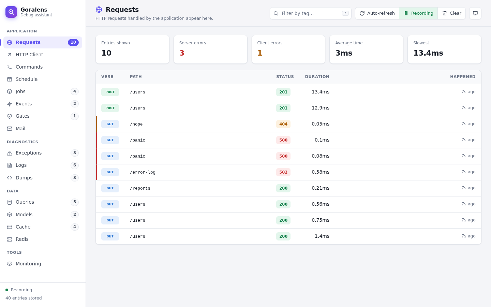
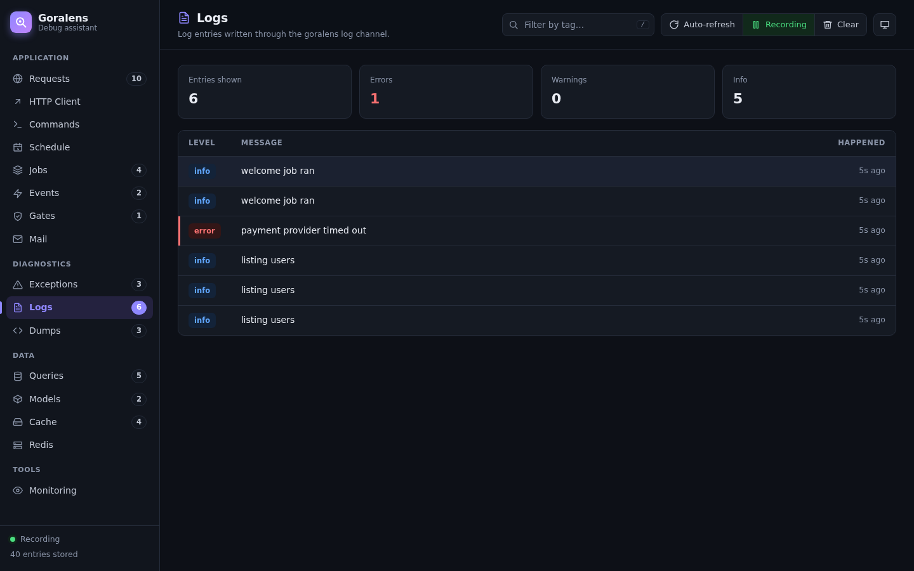

# Goralens

[](https://pkg.go.dev/github.com/beratkara/goralens)
[](https://go.dev/)
[](https://github.com/beratkara/goralens/releases)
[](https://github.com/beratkara/goralens/actions)
[](https://goreportcard.com/report/github.com/beratkara/goralens)


A debug assistant for Goravel, inspired by [Laravel Telescope](https://laravel.com/docs/telescope).

Goralens records what your [Goravel](https://www.goravel.dev) application does: requests,
exceptions, logs, database queries, model changes, events, jobs, mail, cache operations, gate
checks, outgoing HTTP requests, Artisan commands, scheduled tasks and dumps. It shows them in a
dashboard served by the application itself, at `/goralens`.

Everything recorded while one request, command, job or scheduled task runs is linked as a
**batch**. Open a request and you see the queries it ran, the logs it wrote, the jobs it
dispatched and the exception it threw, all on one page.





> **Security:** Goralens stores request payloads, SQL with bindings, mail bodies and log
> context. Sensitive headers and fields are masked, but treat the dashboard as an admin tool.
> Without an `Auth` callback it only opens when `app.env` is `local`. See
> [Authorization](#authorization) before enabling it anywhere else.

## Requirements

- Goravel **v1.18** and Go 1.25+
- The HTTP watcher and dashboard are tested with [goravel/gin](https://github.com/goravel/gin)
- Database storage works with every Goravel database driver (PostgreSQL, MySQL, SQLite and SQL Server)

## Install

Run the command below in your project to install the package automatically:

```bash
./artisan package:install github.com/beratkara/goralens
```

Then create the tables Goralens stores its entries in:

```bash
./artisan migrate
```

Or check [the setup file](./setup/setup.go) to install the package manually.

The install command downloads the package and:

- registers `&goralens.ServiceProvider{}` as a service provider;
- registers `&goralens.Migration{}` with your migrations (in `bootstrap/migrations.go`);
- creates `config/goralens.go` with every option and its default;
- adds a `goralens` channel to `config/logging.go`.

To record your logs, add the `goralens` channel to the stack channel in `config/logging.go`:

```go
"stack": map[string]any{
    "driver":   "stack",
    "channels": []string{"daily", "goralens"},
},
```

Start the application and open `http://localhost:3000/goralens`. Outside the `local`
environment the dashboard stays closed until you set an [authorization](#authorization) callback.

### Manual installation

1. Download the package:

   ```bash
   go get github.com/beratkara/goralens
   ```

2. Register the service provider after the framework's providers.

   In applications using `bootstrap/` (the default since Goravel v1.17), in `bootstrap/providers.go`:

   ```go
   import "github.com/beratkara/goralens"

   func Providers() []foundation.ServiceProvider {
       return []foundation.ServiceProvider{
           &goralens.ServiceProvider{},
       }
   }
   ```

   In older applications, add it to the `providers` list in `config/app.go`.

3. Register the migration and run it. In `bootstrap/migrations.go`:

   ```go
   func Migrations() []schema.Migration {
       return []schema.Migration{
           &goralens.Migration{},
       }
   }
   ```

   In older applications, add it to the list returned by `database/kernel.go`. Then run
   `./artisan migrate`. You can skip this step by keeping entries in memory instead:
   `"storage": map[string]any{"driver": "memory"}` in `config/goralens.go`.

4. Add the log channel to `config/logging.go` and include it in your stack:

   ```go
   "goralens": map[string]any{
       "driver": "custom",
       "via":    goralens.LogDriver(),
   },
   ```

5. Optionally create `config/goralens.go`. Every key has a default; the stub in
   [`setup/stubs.go`](setup/stubs.go) lists all of them.

### Uninstall

```bash
./artisan package:uninstall github.com/beratkara/goralens
```

This removes the provider, the migration registration, the log channel and the config file.
The tables stay; drop `goralens_entries`, `goralens_entries_tags` and `goralens_monitoring` if
you no longer need them.

## Watchers

| Screen | What is recorded | How it hooks into Goravel |
|---|---|---|
| Requests | Method, URI, route, handler, headers, payload, response status/headers/body, duration, IP, user | Global HTTP middleware |
| Exceptions | Panics during requests, jobs and scheduled tasks, plus error-level logs. Includes stack trace and location; repeats are grouped with an occurrence count | The middleware's `recover`, and the log channel |
| Logs | Level, message, context, code, hint, user, tags | The `goralens` custom log channel |
| Queries | SQL with bindings inlined, raw SQL, bindings, duration, rows, error, calling `file:line`; a `slow` tag above the threshold | gorm plugin on the configured connections |
| Models | `created` / `updated` / `deleted`, model, primary key, changed fields | The same gorm plugin |
| Events | Event type, payload, listeners (and whether queued), duration | Wraps the Event facade |
| Jobs | Dispatches (`queued`) and runs (`processed` / `failed`), with arguments, error and duration | Wraps the Queue facade and the jobs registered through it |
| Mail | Subject, from, to, cc, bcc, HTML/text body (HTML preview in a sandboxed frame), attachments, queued or sent | Rebinds the Mail facade |
| Cache | Hits, misses, writes, deletes and flushes, with keys, values and TTL | Wraps the Cache facade (all stores) |
| Gates | Ability, result, arguments, message, location | `Gate().After` callback |
| HTTP Client | Outgoing method, URI, headers, payload, response, duration | Wraps the transport of the Http facade's clients |
| Commands | Artisan command, arguments, exit code, duration | Wraps the Artisan facade |
| Schedule | Each run of a scheduled callback or command, with cron expression, status and duration | Wraps the Schedule facade |
| Dumps | `goralens.Dump(v)` values with their location | Package function |
| Redis | Commands, duration and errors | Optional go-redis hook ([`redishook`](redishook)) |

Turn a watcher off by leaving it out of the `watchers` list in `config/goralens.go`
(see [Choosing watchers](#choosing-watchers)).

### Not supported

- **Notifications:** Goravel v1.18 has no notification component.
- **Views:** Goravel renders templates inside the HTTP driver and gives no hook for it. A
  request's response is still recorded; HTML bodies show as `HTML Response`.

## Batches: how entries are linked

Watchers find the current batch in two ways:

1. **From a context.** Code that passes the request context along, for example
   `facades.Orm().WithContext(ctx)`, `facades.Log().WithContext(ctx)` or `cache.WithContext(ctx)`,
   is linked through it.
2. **From the goroutine.** Go has no request-local storage, and Goravel serves each request on a
   single goroutine. Goralens therefore remembers which batch the request's goroutine works for,
   and code that does not pass the context is still linked.

Work that you start in another goroutine is only linked when it receives the context. Use
`goralens.WithBatch(ctx, batch)` or pass the request context down.

A sync-queue job or an Artisan call made inside a request joins that request's batch. Jobs run
by a worker, commands and scheduled tasks each start their own batch.

## Configuration

`config/goralens.go` (all keys optional):

```go
config.Add("goralens", map[string]any{
    "enabled": config.Env("GORALENS_ENABLED", true),
    "path":    "goralens",

    "middleware":        []goralens.DashboardMiddleware{goralens.Authorize()},
    "allowed_emails":    config.Env("GORALENS_ALLOWED_EMAILS", ""),
    "allowed_users":     map[string]any{"name": []string{"berk"}, "role": []string{"admin"}},
    "token_storage_key": "",
    "session_minutes":   120,

    "storage":         map[string]any{"driver": "database", "connection": ""},
    "ignore_paths":    []string{"/favicon.ico", "/health*"},
    "ignore_commands": []string{"schedule:run"},
    "hidden": map[string]any{
        "request_headers":     []string{"authorization", "cookie"},
        "response_headers":    []string{"set-cookie"},
        "request_parameters":  []string{"password", "password_confirmation", "token"},
        "response_parameters": []string{"token"},
    },

    "watchers": []goralens.Watcher{
        goralens.RequestWatcher{SizeLimit: 64, IgnoreStatusCodes: []int{404}},
        goralens.ClientRequestWatcher{},
        goralens.CommandWatcher{},
        goralens.ScheduleWatcher{},
        goralens.JobWatcher{},
        goralens.EventWatcher{},
        goralens.GateWatcher{IgnoreAbilities: []string{}},
        goralens.MailWatcher{},
        goralens.ExceptionWatcher{},
        goralens.LogWatcher{Level: "info"},
        goralens.DumpWatcher{},
        goralens.QueryWatcher{SlowMs: 100, Connections: []string{"postgres"}},
        goralens.ModelWatcher{},
        goralens.CacheWatcher{HiddenKeys: []string{"session:*"}},
        watchers.Payments{},
    },
})
```

### Configuration reference

Every key is optional. "Env" is the environment variable read when the key is not in
`config/goralens.go`.

| Key | Type | Default | Env | What it does |
|---|---|---|---|---|
| `enabled` | bool | `true` | `GORALENS_ENABLED` | Turns Goralens on or off. When off, nothing is recorded, no middleware or hook is installed and the dashboard does not exist. The `goralens:prune` and `goralens:clear` commands still work. |
| `path` | string | `goralens` | `GORALENS_PATH` | URL path the dashboard is served at. Requests to this path are never recorded. |
| `middleware` | `[]goralens.DashboardMiddleware` | `{goralens.Authorize()}` | | Checks every dashboard request in order; the first one returning `false` closes the dashboard with a 403. See [Authorization](#authorization). |
| `allowed_emails` | string (comma separated) or `[]string` | none | `GORALENS_ALLOWED_EMAILS` | Emails of the users allowed into the dashboard, checked by `goralens.Authorize()` against the signed-in user. |
| `allowed_users` | `map[string]any` | none | | Allowed users by any field: `id`, `name`, `email` or a key of `User.Attributes`, each with a list (or comma separated string) of values. One match is enough. |
| `token_storage_key` | string | none | `GORALENS_TOKEN_STORAGE_KEY` | The `localStorage` key where your frontend keeps its bearer token. When set, the dashboard sends that token with its requests. See [bearer tokens](#applications-that-sign-in-with-a-bearer-token). |
| `session_minutes` | int | `120` | `GORALENS_SESSION_MINUTES` | Lifetime of the cookie set by `POST /goralens/session`. |
| `storage.driver` | string | `database` | `GORALENS_DRIVER` | `database` keeps entries in the `goralens_*` tables (run the migration); `memory` keeps the latest entries in the process until it restarts. |
| `storage.connection` | string | default connection | `GORALENS_DB_CONNECTION` | Database connection the entries are written to. |
| `queue_size` | int | `1000` | | Batches waiting to be written. When the queue is full, new entries are dropped instead of slowing the application down. |
| `flush_interval_ms` | int | `500` | | How often waiting entries are written to storage. |
| `ignore_paths` | `[]string` | `{"/favicon.ico"}` | | Request paths that are not recorded. A trailing `*` matches any suffix, for example `/health*`. |
| `ignore_commands` | `[]string` | none | | Artisan commands that are not recorded, for example `schedule:run`. |
| `hidden.request_headers` | `[]string` | `authorization`, `cookie`, `proxy-authorization`, `x-csrf-token`, `x-xsrf-token`, `x-api-key` | | Request headers stored as `********`. |
| `hidden.response_headers` | `[]string` | `set-cookie` | | Response headers stored as `********`. |
| `hidden.request_parameters` | `[]string` | `password`, `password_confirmation`, `current_password`, `new_password`, `token`, `access_token`, `refresh_token`, `secret`, `_token` | | Fields stored as `********` in query strings, form and JSON bodies (nested ones too), for every HTTP method and for outgoing HTTP client requests. |
| `hidden.response_parameters` | `[]string` | `token`, `access_token`, `refresh_token` | | Fields stored as `********` in JSON responses. |
| `watchers` | `[]goralens.Watcher` | `goralens.DefaultWatchers()` | | Which watchers run, with their options. A watcher left out of the list does not run. See [Choosing watchers](#choosing-watchers). |

Listing a key replaces its default; to add a hidden field, repeat the defaults you want to keep.

### Choosing watchers

Like Laravel Telescope, the `watchers` list decides what is recorded: a watcher in the list runs,
a watcher left out does not. Delete or comment out a line to turn that watcher off, add your own
watcher to the list to turn it on. In the example above `RedisWatcher` is missing, so Redis
commands are not recorded, and the custom `Payments` watcher runs.

Options live on each watcher:

| Watcher | Options |
|---|---|
| `RequestWatcher` | `SizeLimit` (KB of response kept, default 64), `IgnoreStatusCodes` |
| `QueryWatcher` | `SlowMs` (slow query threshold, default 100), `Connections` (default: the default connection) |
| `LogWatcher` | `Level` (lowest level recorded, default `debug`) |
| `ExceptionWatcher` | `IgnoreErrorLogs` (do not turn error-level logs into exceptions) |
| `GateWatcher` | `IgnoreAbilities` (a trailing `*` matches any suffix) |
| `CacheWatcher` | `HiddenKeys` (values of these keys are masked; a trailing `*` matches any suffix) |

Without a `watchers` key every built-in watcher runs with its defaults, the same list
`goralens.DefaultWatchers()` returns.

### Environment variables

Each of these works on its own, in `.env` or the process environment, even when the key is
missing from `config/goralens.go` (or the file does not exist). A value written in the config
file wins over the environment.

| Variable | Setting | Default |
|---|---|---|
| `GORALENS_ENABLED` | Turn Goralens on or off (`true` / `false`) | `true` |
| `GORALENS_PATH` | URL path of the dashboard | `goralens` |
| `GORALENS_DRIVER` | `database` or `memory` | `database` |
| `GORALENS_DB_CONNECTION` | Database connection for the entries | default connection |
| `GORALENS_ALLOWED_EMAILS` | Comma separated emails allowed into the dashboard | none |
| `GORALENS_TOKEN_STORAGE_KEY` | `localStorage` key of your bearer token (see [bearer tokens](#applications-that-sign-in-with-a-bearer-token)) | none |
| `GORALENS_SESSION_MINUTES` | Lifetime of a Goralens session cookie | `120` |

For example, on a staging server where only you may open the dashboard:

```bash
GORALENS_ENABLED=true
GORALENS_ALLOWED_EMAILS=admin@example.com
GORALENS_TOKEN_STORAGE_KEY=app_token
```

## Masking sensitive data

Every request, whatever its method (GET, POST, PUT, PATCH, DELETE), is recorded with its query
string, form fields, JSON body, headers and response. Before an entry is stored, these are
replaced with `********`:

- request and response headers listed in `hidden.request_headers` / `hidden.response_headers`
  (by default `Authorization`, `Cookie`, `Proxy-Authorization`, CSRF tokens, `X-Api-Key` and
  `Set-Cookie`);
- fields listed in `hidden.request_parameters` wherever they appear: in the query string of the
  recorded URI, in form and JSON bodies, and inside nested objects and arrays (by default
  `password`, `password_confirmation`, `current_password`, `new_password`, `token`,
  `access_token`, `refresh_token`, `secret` and `_token`);
- fields listed in `hidden.response_parameters` in JSON responses;
- the same lists for outgoing HTTP client requests, including form encoded bodies and passwords
  in URLs.

Field names match whole keys, without regard to case.

## Authorization

The dashboard should only be open to the people debugging the application. Its requests go
through the `middleware` list in the configuration, in order; the first one that returns `false`
closes the dashboard with a 403 (unless it already wrote its own response, such as a redirect).

The default list holds `goralens.Authorize()`, which decides in this order:

1. If a callback was registered with `goralens.Auth`, its answer.
2. If `allowed_emails` or `allowed_users` is set, whether the signed-in user matches it.
3. Otherwise the dashboard is open only when `app.env` is `local`.

### Allowing users by email, name or any other field

Tell Goralens who is signed in. The dashboard is opened in a browser, so the resolver has to
recognize the user the way your web pages do, for example from the session:

```go
goralens.ResolveUser(func(ctx http.Context) *goralens.User {
    var user models.User
    if err := facades.Auth(ctx).User(&user); err != nil {
        return nil
    }
    return &goralens.User{
        ID:         user.ID,
        Name:       user.Name,
        Email:      user.Email,
        Attributes: map[string]any{"role": user.Role, "team": user.Team},
    }
})
```

Then list who may come in. Matching ignores case and surrounding spaces, and one match is
enough:

```go
"allowed_emails": "admin@example.com, ops@example.com",
"allowed_users": map[string]any{
    "name": []string{"berk"},
    "id":   []string{"1", "42"},
    "role": []string{"admin"},
},
```

`id`, `name` and `email` read the fields of the same name; any other key reads `Attributes`.
`GORALENS_ALLOWED_EMAILS` takes a comma separated list. The same rules work as middleware:

```go
"middleware": []goralens.DashboardMiddleware{
    goralens.AllowEmails("admin@example.com"),
    goralens.AllowUsers("role", "admin", "developer"),
},
```

### Applications that sign in with a bearer token

When the application keeps its session in a cookie, `ResolveUser` can read the user as usual:
the browser sends the cookie when the dashboard opens. Applications that keep a token in
`localStorage` and send it as `Authorization: Bearer ...` need one more step, because a browser
never adds that header when it opens a page by itself. `ResolveUser` stays the same in both
cases, reading the bearer token:

```go
goralens.ResolveUser(func(ctx http.Context) *goralens.User {
    var user models.User
    if err := facades.Auth(ctx).User(&user); err != nil {
        return nil
    }
    return &goralens.User{ID: user.ID, Name: user.Name, Email: user.Email}
})
```

**Frontend on the same domain as the API.** Tell Goralens where the token is stored:

```go
"token_storage_key": "app_token",
```

The dashboard page and its script then load without authorization, read the token from
`localStorage` and send it with every request. Every endpoint that returns data still goes
through the middleware, so someone without an allowed token only sees an "access" message.

**Frontend on another domain** (for example `example.com` with the API on `api.example.com`).
`localStorage` is not shared between domains, so the frontend hands the token over once. Post it
from a page where the user is signed in:

```js
const form = document.createElement('form')
form.method = 'POST'
form.action = 'https://api.example.com/goralens/session'
form.target = '_blank'
const field = Object.assign(document.createElement('input'), { type: 'hidden', name: 'token', value: localStorage.getItem('app_token') })
form.append(field)
document.body.append(form)
form.submit()
form.remove()
```

Goralens resolves the user from the token, runs the middleware and, when the user is allowed,
sets a signed, HttpOnly cookie (valid for `session_minutes`, default 120) and redirects to the
dashboard. The token is sent in the request body, so it does not end up in the address bar or
access logs. `DELETE /goralens/api/session` signs out.

Inside your own checks, `goralens.CurrentUser(ctx)` returns the user of the request: the one from
the Goralens session, or the one `ResolveUser` finds.

### Your own middleware

A `goralens.DashboardMiddleware` is a `func(ctx http.Context) bool`. Return `true` to let the
request through:

```go
"middleware": []goralens.DashboardMiddleware{
    goralens.Authorize(),
    func(ctx http.Context) bool {
        return strings.HasPrefix(ctx.Request().Ip(), "10.")
    },
},
```

A callback registered with `goralens.Auth` replaces the decision of `goralens.Authorize()`:

```go
goralens.Auth(func(ctx http.Context) bool {
    user := goralens.CurrentUser(ctx)
    return user != nil && user.Attributes["is_admin"] == true
})
```

Changes made from the dashboard (pausing, clearing, monitoring) must also carry an `X-Goralens`
header, which cross-site forms cannot send.

## Custom watchers

A watcher is a type with a name and a `Register` method. `Register` runs once, when the
application boots, and hooks into whatever you want to watch; entries are recorded with
`goralens.Record`. The name becomes the entry type: lowercase letters, digits and underscores,
different from the built-in watchers.

```go
package watchers

import (
    "context"

    "github.com/beratkara/goralens"
    "github.com/goravel/framework/contracts/foundation"
)

type Payments struct{}

func (Payments) Name() string { return "payment" }

func (Payments) Register(app foundation.Application) error {
    return nil
}

func (Payments) Describe() goralens.WatcherInfo {
    return goralens.WatcherInfo{
        Title: "Payments",
        Group: "Billing",
        Hint:  "Payments taken at checkout.",
        Columns: []goralens.Column{
            {Label: "Order", Field: "order"},
            {Label: "Amount", Field: "amount"},
            {Label: "Status", Field: "status"},
        },
    }
}

func RecordPayment(ctx context.Context, order string, amount float64, status string) {
    e := goralens.NewEntry("payment", map[string]any{"order": order, "amount": amount, "status": status})
    e.AddTags("order:" + order)
    goralens.Record(ctx, e)
}
```

Add it to the `watchers` list in the configuration, next to the built-in ones, or call
`goralens.RegisterWatcher(&watchers.Payments{})` before the application boots. Passing the request context to `goralens.Record` puts the entry in
the request's batch, next to its queries and logs.

`Describe` is optional. With it, the dashboard shows the watcher in the given group, with the
title, the empty-screen hint and the listed columns; without it, the watcher appears under
**Custom** and its entries are listed by their content. Every entry opens with its full content
and related entries, like the built-in screens.

## Users, tags, filters and monitoring

A user resolver shows who made a request and tags every entry of its batch `Auth:<id>`:

```go
goralens.ResolveUser(func(ctx http.Context) *goralens.User {
    if u := currentUser(ctx); u != nil {
        return &goralens.User{ID: u.ID, Name: u.Name, Email: u.Email}
    }
    return nil
})
```

Add your own tags:

```go
goralens.Tag(func(e *goralens.Entry) []string {
    if e.Type == goralens.TypeRequest && e.Content["response_status"] == 500 {
        return []string{"server-error"}
    }
    return nil
})
```

Store only what you need; entries with a monitored tag are always stored:

```go
goralens.Filter(func(e *goralens.Entry) bool {
    return e.Type != goralens.TypeCache
})
```

Built-in tags:

| Tag | Applied to |
|---|---|
| `Auth:<id>` | Every entry of a batch, when a user resolver is set |
| `slow` | Slow queries |
| `processed` / `queued` / `failed` | Jobs |
| `<Model>:<key>` | Model changes |
| `mail:<address>` | Mail |
| Exception type | Exceptions |
| Host name | HTTP client requests |

Search any tag from the dashboard. On the **Monitoring** screen you can mark tags to keep
recording them even when a filter would drop them.

## Pruning

`goralens:prune` deletes entries older than the given hours, `goralens:clear` deletes everything:

```bash
./artisan goralens:prune --hours=48
./artisan goralens:clear
```

Schedule the prune command in `bootstrap/app.go`:

```go
WithSchedule(func() []schedule.Event {
    return []schedule.Event{facades.Schedule().Command("goralens:prune --hours=48").Daily()}
}),
```

## More integrations

**Dumps**

`Dump` links the values to the current request, command or job; use `DumpContext` when you
have the context in another goroutine:

```go
goralens.Dump(order, user)
goralens.DumpContext(ctx, payload)
```

**HTTP clients you build yourself**

```go
client := &http.Client{Transport: goralens.Transport(nil)}
```

**Redis (go-redis v9)**

```bash
go get github.com/beratkara/goralens/redishook
```

```go
client.AddHook(redishook.New("default"))
```

**Custom entries**

```go
goralens.Record(ctx, &goralens.Entry{Type: goralens.TypeLog, Content: map[string]any{"level": "info", "message": "imported 120 rows"}})
```

## Performance

- Entries are buffered and written by a background goroutine in batches. A slow or failing
  database never blocks a request; storage errors are printed to stderr at most once a minute.
- Goralens's own queries are never recorded.
- The cache watcher makes one extra `Has` call per read to tell hits from misses.

Goralens is meant for development and staging. To keep it off in production without
uninstalling it, set `GORALENS_ENABLED=false`.

## Limitations

- Facades are wrapped after the framework providers boot. A service that resolved a facade
  before that keeps the unwrapped instance; facades resolved later, including all calls through
  `facades.X()`, are recorded.
- Mail is recorded when Goravel's own mailer is in use. A custom mail binding is left alone.
- Commands are recorded when the application runs them through `artisan`, as Goravel apps do
  by default.
- The pause switch applies to the running process; it is not shared between instances.

## Testing

Unit tests, then a real Goravel app on SQLite that exercises every watcher, then the Redis hook:

```bash
go test ./...
(cd examples/basic && go test ./...)
(cd redishook && go test ./...)
```

Test coverage of the package, from the unit tests and the example application together (72.5%
for v0.1.0):

```bash
mkdir -p /tmp/cover/unit /tmp/cover/example
go test -cover -coverpkg=github.com/beratkara/goralens . -args -test.gocoverdir=/tmp/cover/unit
(cd examples/basic && go test -cover -coverpkg=github.com/beratkara/goralens . -args -test.gocoverdir=/tmp/cover/example)
go tool covdata percent -i=/tmp/cover/unit,/tmp/cover/example -pkg=github.com/beratkara/goralens
```

## License

MIT, see [LICENSE](LICENSE).
